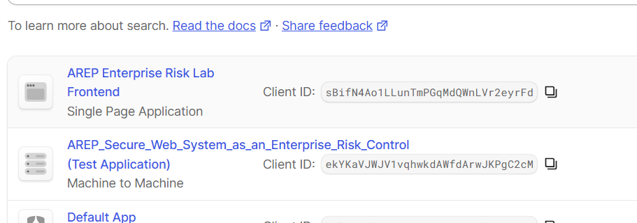
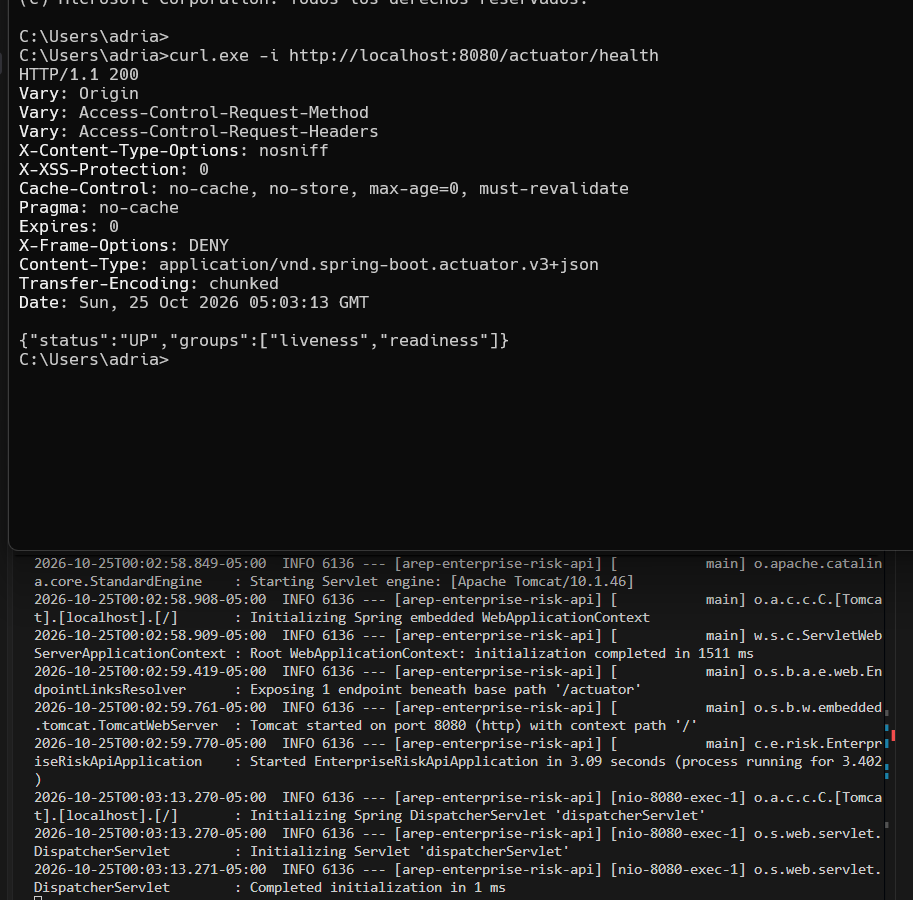
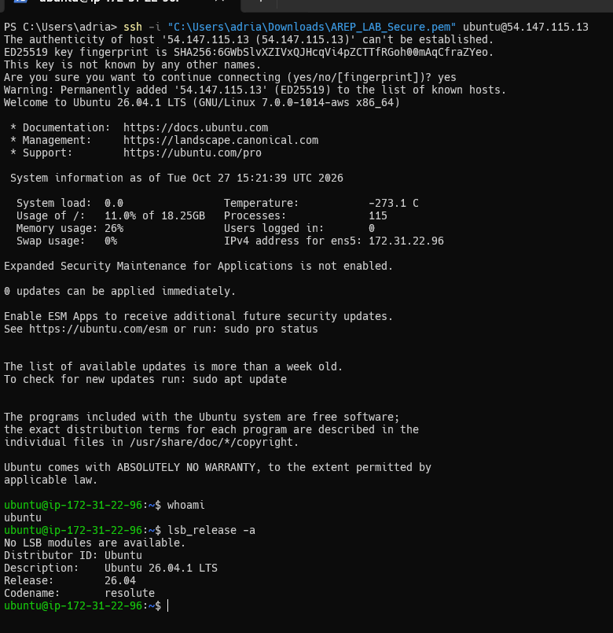
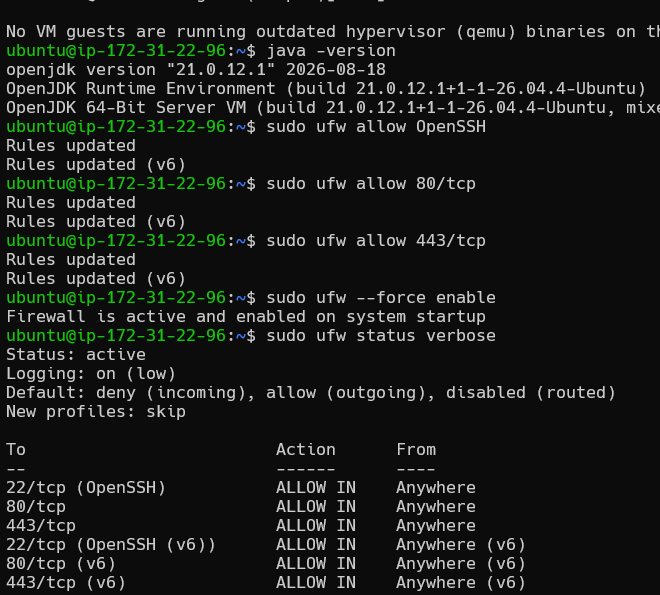
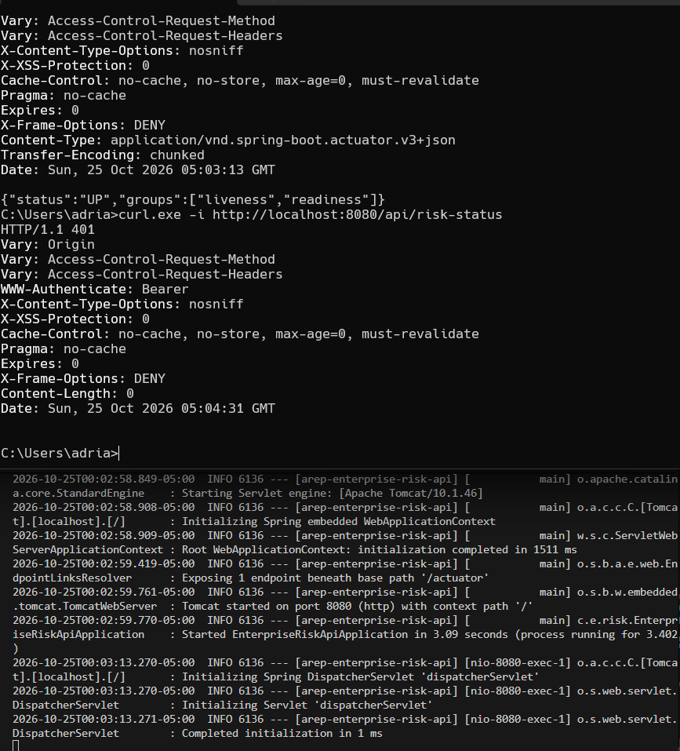
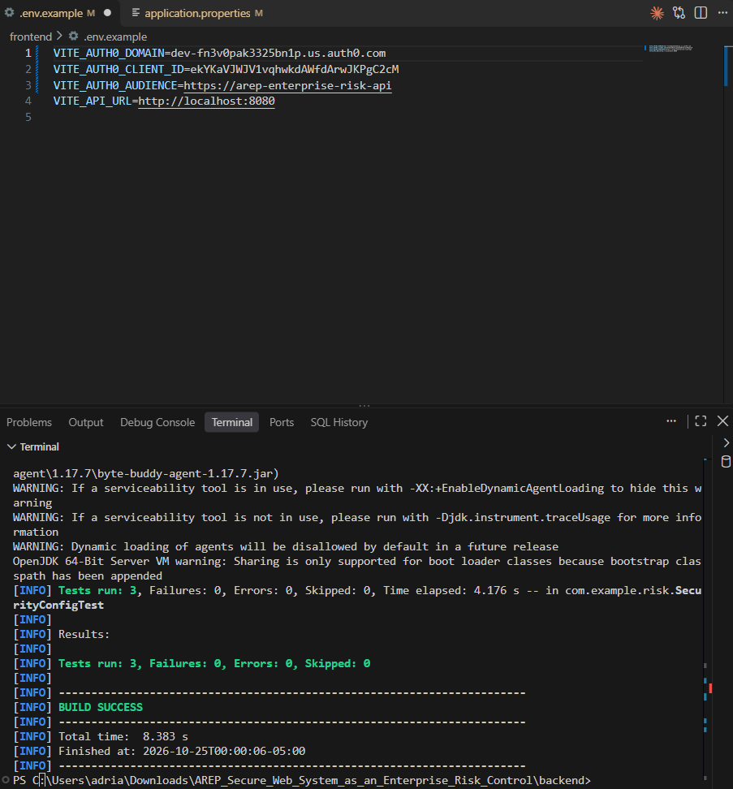
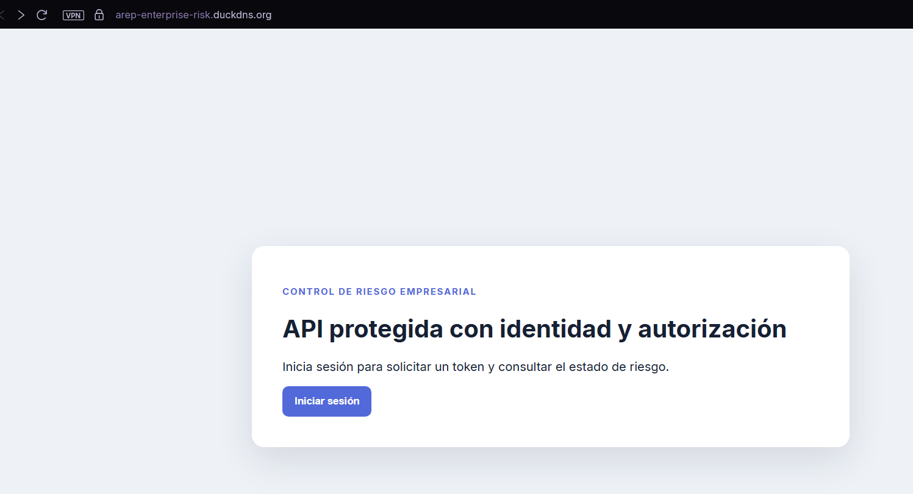
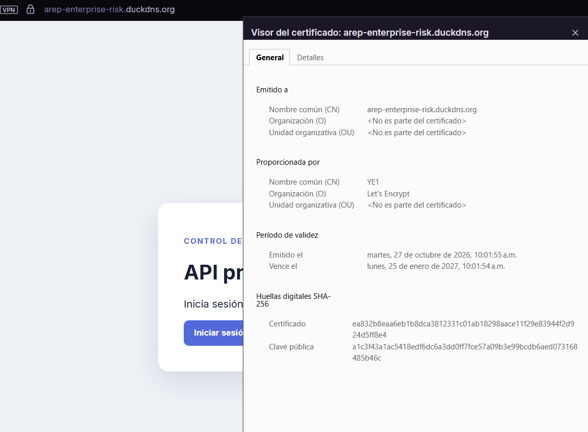
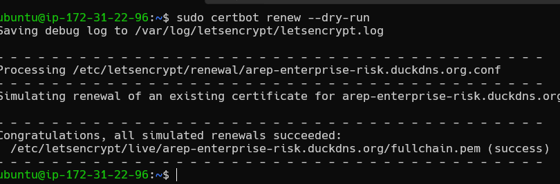

# Secure Web System as an Enterprise Risk Control

AREM workshop implementation: a React SPA authenticates users with Auth0 and
consumes a Spring Boot API that validates the JWT issuer, audience, and
`read:risk` permission. In production, Apache serves the SPA and reverse
proxies `/api/` to the local backend; only ports 80 and 443 are public.

## Delivery status

The application is published at:

<https://arep-enterprise-risk.duckdns.org>

The backend runs as the dedicated `riskapi` user and is bound to
`127.0.0.1:8080`. Apache serves the SPA and proxies only `/api/` to the
backend. The firewall allows SSH, HTTP, and HTTPS and blocks port 8080.

The deployment, HTTPS termination, reverse proxy, firewall, backend process,
and unauthenticated API protection have been verified. Auth0 is configured in
the project with the issuer, client ID, audience, callback URL, and
`read:risk` permission described below. The successful authenticated response
must be verified from the deployed SPA before treating the end-to-end flow as
complete.

### Evidence gallery

The following evidence is stored in [docs/images](./docs/images/):

#### Auth0 SPA registration



#### Local health check



#### Ubuntu server access



#### Java and firewall configuration



#### Protected endpoint without a token



#### Backend tests



#### HTTPS deployment



#### TLS certificate



#### Certificate renewal



Screenshots must not expose access tokens, client secrets, or passwords. The
end-to-end authenticated evidence is the response from the deployed SPA showing
`status: "protected"` and the user's `subject`.

### Completed checks

```text
DNS:
arep-enterprise-risk.duckdns.org -> 54.147.115.13

Frontend:
HTTPS responds with 200 OK

Unauthenticated API:
HTTPS /api/risk-status responds with 401 Unauthorized

CORS:
The preflight from https://arep-enterprise-risk.duckdns.org responds with 200

Backend:
enterprise-risk-api.service is active (running)
Spring Boot is bound to 127.0.0.1:8080

Certbot:
Congratulations, all simulated renewals succeeded

Build:
mvn clean test -> 3 tests, 0 failures
npm run build -> successful
```

The deployed configuration uses:

```text
Auth0 issuer: https://dev-fn3v0pak3325bn1p.us.auth0.com/
Auth0 audience: https://arep-enterprise-risk-api
Production URL: https://arep-enterprise-risk.duckdns.org
```

## 1. Key concepts

- **Authentication** answers “who are you?”. Auth0 performs the login and
  issues an access token.
- **Authorization** answers “what are you allowed to do?”. The API requires
  the `read:risk` scope in addition to a valid JWT.
- **Issuer** identifies the tenant that signed the token.
- **Audience** identifies the API for which the token was issued and prevents
  token reuse against another service.
- **HTTPS** encrypts credentials and tokens in transit.

## 2. Auth0 configuration

1. In **Applications → APIs**, create an API named `AREP Enterprise Risk API`
   with this exact Identifier and the `RS256` signing algorithm:

   ```text
   https://arep-enterprise-risk-api
   ```

2. In **Permissions**, add:

   ```text
   Permission: read:risk
   Description: Read the protected risk status
   ```

3. Create an application of type **Single Page Application** named `AREP
   Enterprise Risk Lab Frontend`.
4. In the SPA under **APIs → User-Delegated Access**, grant `read:risk` to the
   API. **Client Access does not replace User-Delegated Access** for a SPA
   login.
5. Create a test user under **Authentication → Database → Users**.
6. Configure these exact SPA URLs:

   ```text
   Allowed Callback URLs:
   https://arep-enterprise-risk.duckdns.org

   Allowed Logout URLs:
   https://arep-enterprise-risk.duckdns.org

   Allowed Web Origins:
   https://arep-enterprise-risk.duckdns.org
   ```

Never copy a client secret into the SPA. Vite values are visible in the
browser bundle; only the client ID is appropriate for this flow.

## 3. Local execution

### Backend

From `backend/`:

```powershell
$env:AUTH0_ISSUER_URI="https://dev-fn3v0pak3325bn1p.us.auth0.com/"
$env:AUTH0_AUDIENCE="https://arep-enterprise-risk-api"
$env:APP_CORS_ALLOWED_ORIGINS="http://localhost:5173"
mvn spring-boot:run
```

Without a token, this request must return `401`:

```powershell
curl.exe -i http://localhost:8080/api/risk-status
```

The public health endpoint must return `200`:

```powershell
curl.exe -i http://localhost:8080/actuator/health
```

### Frontend

From `frontend/`, create `.env.local` from `.env.example` and fill in the
tenant and client ID. Never commit this file.

```powershell
Copy-Item .env.example .env.local
npm install
npm run dev
```

Open `http://localhost:5173`, sign in, and select **Call protected API**. A
successful response contains `status: "protected"` and the user's `subject`.
The browser never displays or manually stores the access token.

## 4. Ubuntu, Duck DNS, and Apache deployment

Use a server you control. Change default credentials, create a non-root
deployment user, and allow only TCP 80, 443, and restricted SSH through the
firewall. Never expose port 8080.

Install the required packages:

```bash
sudo apt update
sudo apt install -y apache2 certbot python3-certbot-apache openjdk-21-jre
```

Build on a trusted development machine or CI runner:

```powershell
cd backend
mvn clean package
cd ../frontend
# Set VITE_API_URL to https://arep-enterprise-risk.duckdns.org in .env.local
npm run build
```

Copy `backend/target/*.jar` and `frontend/dist/` using `scp` or another secure
transfer method. Run the JAR as a dedicated user and bind it to loopback with
systemd:

```ini
[Unit]
Description=Enterprise Risk API
After=network.target

[Service]
User=riskapi
WorkingDirectory=/opt/enterprise-risk-api
Environment="AUTH0_ISSUER_URI=https://dev-fn3v0pak3325bn1p.us.auth0.com/"
Environment="AUTH0_AUDIENCE=https://arep-enterprise-risk-api"
Environment="APP_CORS_ALLOWED_ORIGINS=https://arep-enterprise-risk.duckdns.org"
Environment="SERVER_ADDRESS=127.0.0.1"
ExecStart=/usr/bin/java -jar /opt/enterprise-risk-api/app.jar
Restart=always

[Install]
WantedBy=multi-user.target
```

Apache serves `dist/` and proxies only `/api/` to
`http://127.0.0.1:8080/api/`. Enable `ssl`, `proxy`, `proxy_http`, `rewrite`,
and `headers`. The ready-to-copy templates are
`deploy/enterprise-risk-api.service` and `deploy/enterprise-risk.conf`.

Run:

```bash
sudo apachectl configtest
sudo systemctl reload apache2
sudo certbot --apache -d arep-enterprise-risk.duckdns.org
sudo certbot renew --dry-run
```

After obtaining HTTPS, update the three Auth0 allowed URLs and rebuild the
frontend with the HTTPS API URL. Delivery evidence must include a successful
authenticated call, a valid certificate, successful `certbot renew --dry-run`,
a `401` without a token, and proof that port 8080 is not public.

## 5. Auth0 configuration reference

The deployed bundle contains:

```text
VITE_AUTH0_DOMAIN=dev-fn3v0pak3325bn1p.us.auth0.com
VITE_AUTH0_AUDIENCE=https://arep-enterprise-risk-api
VITE_API_URL=https://arep-enterprise-risk.duckdns.org
```

The same values must be present in the Auth0 tenant and in the deployed
frontend/backend:

```text
API Identifier: https://arep-enterprise-risk-api
Permission: read:risk
Issuer: https://dev-fn3v0pak3325bn1p.us.auth0.com/
SPA callback URL: https://arep-enterprise-risk.duckdns.org
```

The SPA must receive `read:risk` through **User-Delegated Access**. The API
Identifier, issuer, and client ID must belong to the same Auth0 tenant.

## 6. End-to-end authenticated verification

After confirming the Auth0 values above:

1. Open <https://arep-enterprise-risk.duckdns.org>.
2. Sign in with the test user.
3. Select **Call protected API**.
4. Save a screenshot showing the HTTPS URL and a response like:

   ```json
   {
     "status": "protected",
     "subject": "auth0|..."
   }
   ```

5. Confirm that no complete token is visible.

## 7. Controlled risks

| Control | Reduced risk | Evidence |
| --- | --- | --- |
| Auth0 | Impersonation and weak credential handling | Auth0 login and user identity |
| JWT issuer/audience | Unauthorized API access and token reuse | `401`/`403` responses and configuration |
| `read:risk` scope | Use of an authenticated identity without permission | `403` response without the scope |
| HTTPS | Credential or token exposure in transit | Browser certificate |
| Apache reverse proxy | Direct exposure of port 8080 | Only ports 80 and 443 are public |
| Service logs | Delayed incident investigation | `journalctl -u enterprise-risk-api` |
